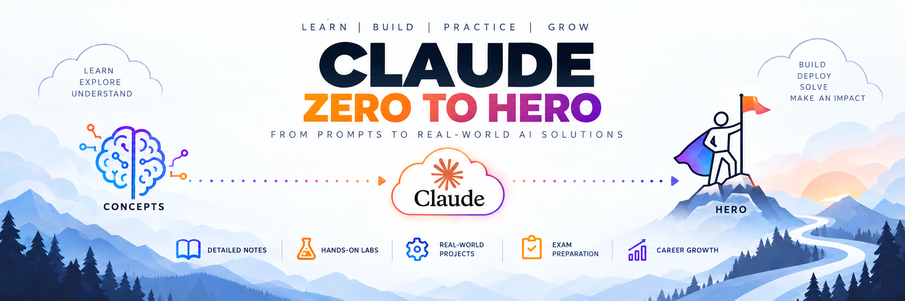

<!--
  Claude Zero to Hero
  Independent learning repository for Claude AI and Generative AI.
  Replace the banner path if you use a different image filename.
-->

<p align="center">
  
</p>

<p align="center">
  <strong>LEARN | BUILD | PRACTICE | GROW</strong>
</p>

<h1 align="center">Claude AI & Generative AI — Zero to Hero</h1>

<p align="center">
  <strong>From AI Fundamentals to Professional AI Workflows</strong>
</p>

<p align="center">
  
  
  
  
  
  
</p>

<p align="center">
  A structured learning path from AI fundamentals and effective Claude use to professional workflows, agentic AI concepts, hands-on labs, and practical projects.
</p>

---

## 🌟 About This Repository

Welcome to **Claude AI & Generative AI — Zero to Hero**, a structured learning repository designed to take learners from the fundamentals of generative AI to practical, responsible, and effective use of Claude in professional environments.

This repository combines detailed explanations, practical examples, hands-on exercises, reusable prompt templates, real-world scenarios, agentic AI foundations, and certification preparation materials.

Instead of simply teaching users how to ask questions to an AI assistant, this learning path focuses on understanding how AI works, providing the right context, evaluating generated responses, improving workflows, and using AI responsibly.

The course progresses from using AI assistants to designing repeatable workflows and understanding tool-using AI agents. Advanced agent development is an optional extension, not a prerequisite for the core course or the Associate certification path. The skills covered here are transferable to other AI assistants and tools, including ChatGPT, Gemini, and Microsoft Copilot.

Whether you are a student, software developer, DevOps engineer, QA engineer, data analyst, business professional, or someone beginning their AI journey, this repository provides a structured path for developing practical AI skills.

> **Important:** This is an independent educational resource. It is not an official Anthropic course and is not affiliated with or endorsed by Anthropic.

---

## 🎯 Learning Outcomes

By completing this repository, you will learn how to:

- Understand artificial intelligence, generative AI, and large language models.
- Explain tokens, context windows, model capabilities, and AI limitations.
- Understand Claude and select suitable capabilities for different tasks.
- Write effective prompts using context, instructions, examples, and constraints.
- Improve AI responses through iterative prompting.
- Evaluate AI-generated content for accuracy, relevance, completeness, and reliability.
- Identify hallucinations and verify information using reliable sources.
- Use Claude for research, summarization, writing, analysis, and problem-solving.
- Organize work using Claude Projects, project instructions, and reference documents.
- Design practical AI-assisted workflows.
- Apply AI to software development, DevOps, cloud engineering, testing, and business tasks.
- Recognize privacy, security, copyright, and responsible AI considerations.
- Troubleshoot ineffective AI interactions and improve output quality.
- Build practical projects using AI-assisted workflows.
- Explain the difference between AI assistants, workflow automation, and agentic AI systems.
- Understand agent loops, tool use, memory, orchestration, and human approval at an introductory level.
- Recognize the safety, security, and evaluation challenges of tool-using AI systems.
- Prepare for the Claude Certified Associate – Foundations certification using the current official exam blueprint.

---

## 👥 Who Is This Repository For?

This learning path is designed for:

| Audience | What You Will Learn |
|---|---|
| Beginners | Understand generative AI and use Claude effectively. |
| Students | Develop AI literacy and practical workplace skills. |
| Software Developers | Assist with coding, debugging, testing, and documentation. |
| DevOps & Cloud Engineers | Analyze logs, troubleshoot configurations, and improve automation workflows. |
| QA Engineers | Generate test cases, explore edge cases, and analyze defects. |
| Data Analysts | Assist with SQL, data interpretation, and reporting. |
| Business Professionals | Improve research, communication, documentation, and productivity. |
| IT Professionals | Apply AI across technical and operational workflows. |
| Certification Candidates | Review core concepts and practice scenario-based questions. |

No advanced programming knowledge is required for the core learning modules.

Programming knowledge is useful for the developer, DevOps, and advanced AI modules.

---

## 🗺️ Learning Roadmap

Follow the modules in order for the recommended learning experience.

```text
START
  |
  v
Generative AI Fundamentals
  |
  v
Introduction to Claude
  |
  v
Prompt Engineering
  |
  v
Output Evaluation and Validation
  |
  v
AI-Assisted Workflows
  |
  v
Projects and Knowledge Management
  |
  v
Responsible AI and Governance
  |
  v
Troubleshooting and Optimization
  |
  +-------------------------------+
  |                               |
  v                               v
AI Specializations          Certification Prep
  |                               |
  v                               v
Hands-on Labs               Practice Exams
  |                               |
  +---------------+---------------+
                  |
                  v
           Capstone Projects
                  |
                  v
                 END
```

---

## 🧭 Choose Your Learning Path

You do not need to complete every module for every goal. Choose the path that matches your needs:

| Path | Recommended Modules | Goal |
|---|---|---|
| **AI Beginner** | 00–08, then selected labs | Build AI literacy and learn to use Claude effectively and responsibly. |
| **Claude Associate Preparation** | 00–08 plus 14, using the current official exam blueprint | Focus on the certification's published domains; the advanced agent module is optional. |
| **Professional AI User** | 00–12, plus relevant labs and a capstone | Apply Claude to your role and build repeatable workflows. |
| **Agentic AI Explorer** | Core modules plus 13, 15.9, and optionally 16.5 | Learn agent concepts and build a small, safety-conscious tool-using example. |

The advanced path is an extension of the course, not a requirement for beginners or certification candidates. Agent examples should use restricted permissions and simulated or non-production environments unless a carefully reviewed deployment process is in place.

---

## ⏱️ Suggested Study Plans

These are suggested study schedules, not official certification requirements.

| Study Plan | Daily Commitment | Suitable For |
|---|---|---|
| 7-Day Intensive | 2–3 hours | Learners who want a quick introduction and focused revision. |
| 14-Day Plan | 1–2 hours | Learners balancing study with other responsibilities. |
| 30-Day Plan | 45–90 minutes | Beginners who want time for practical exercises. |

The actual time required depends on your prior experience, the depth of study, and the optional specialization modules you complete.

---

## 📚 Table of Contents

| Module | Topic | Description |
|---|---|---|
| 00 | [Getting Started](#00-getting-started) | Understand the course and learning roadmap. |
| 01 | [Generative AI Fundamentals](#01-generative-ai-fundamentals) | Learn LLMs, tokens, context windows, and limitations. |
| 02 | [Introduction to Claude](#02-introduction-to-claude) | Explore Claude and its capabilities. |
| 03 | [Prompt Engineering](#03-prompt-engineering) | Learn to write effective prompts. |
| 04 | [Output Evaluation and Validation](#04-output-evaluation-and-validation) | Evaluate and validate AI responses. |
| 05 | [AI-Assisted Workflows](#05-ai-assisted-workflows) | Apply AI to real-world tasks. |
| 06 | [Projects and Knowledge Management](#06-projects-and-knowledge-management) | Organize instructions and reference material. |
| 07 | [Responsible AI and Governance](#07-responsible-ai-and-governance) | Learn privacy, security, and responsible AI. |
| 08 | [Troubleshooting and Optimization](#08-troubleshooting-and-optimization) | Improve AI responses and workflows. |
| 09 | [AI for Software Developers](#09-ai-for-software-developers) | Apply AI to coding and debugging. |
| 10 | [AI for DevOps and Cloud](#10-ai-for-devops-and-cloud-engineering) | Apply AI to CI/CD and cloud operations. |
| 11 | [AI for QA and Testing](#11-ai-for-qa-and-testing) | Improve test design and defect analysis. |
| 12 | [AI for Data and Business](#12-ai-for-data-and-business) | Apply AI to analysis and reporting. |
| 13 | [Agentic AI and Advanced Concepts](#13-agentic-ai-and-advanced-concepts) | Explore AI agents, tool use, MCP, APIs, RAG, and agent evaluation. |
| 14 | [Certification Preparation](#14-claude-certification-preparation) | Prepare for the Claude certification. |
| 15 | [Hands-On Labs](#15-hands-on-labs) | Practise with guided exercises. |
| 16 | [Capstone Projects](#16-capstone-projects) | Build practical AI-assisted projects. |
| 17 | [Revision and Reference](#17-revision-and-reference) | Review important concepts and resources. |
---

---

# 00. Getting Started

Build a clear understanding of the learning path before beginning the technical modules.

📂 **Explore:** [Getting Started](00-Getting-Started/)

| # | Sub-Topic | Description |
|---|---|---|
| 0.1 | [Repository Overview](00-Getting-Started/01-Repository-Overview.md) | Understand the purpose and structure of this repository. |
| 0.2 | [Who Should Learn Generative AI?](00-Getting-Started/02-Who-Should-Learn-Generative-AI.md) | Explore different learning paths and career applications. |
| 0.3 | [Prerequisites](00-Getting-Started/03-Prerequisites.md) | Identify the tools and knowledge needed to begin. |
| 0.4 | [Learning Roadmap](00-Getting-Started/04-Learning-Roadmap.md) | Follow the recommended sequence of modules. |
| 0.5 | [Study Plans](00-Getting-Started/05-Study-Plans.md) | Choose an intensive, two-week, or monthly schedule. |
| 0.6 | [Certification Overview](00-Getting-Started/06-Certification-Overview.md) | Understand the role of certification preparation in this course. |

---

# 01. Generative AI Fundamentals

Build a strong foundation in artificial intelligence, generative AI, large language models, and the concepts required to understand modern AI assistants.

📂 **Explore:** [Generative AI Fundamentals](01-Generative-AI-Fundamentals/)

| # | Sub-Topic | Description |
|---|---|---|
| 1.1 | [Introduction to Artificial Intelligence](01-Generative-AI-Fundamentals/01-Introduction-to-Artificial-Intelligence/README.md) | Understand AI and its applications. |
| 1.2 | [Machine Learning Fundamentals](01-Generative-AI-Fundamentals/02-Machine-Learning-Fundamentals/README.md) | Learn how machine learning differs from traditional programming. |
| 1.3 | [Introduction to Generative AI](01-Generative-AI-Fundamentals/03-Introduction-to-Generative-AI/README.md) | Understand how generative AI creates content. |
| 1.4 | [Understanding Large Language Models](01-Generative-AI-Fundamentals/04-Understanding-Large-Language-Models/README.md) | Learn the basic principles behind LLMs. |
| 1.5 | [How LLMs Generate Responses](01-Generative-AI-Fundamentals/05-How-LLMs-Generate-Responses/README.md) | Understand next-token prediction at a high level. |
| 1.6 | [Tokens and Tokenization](01-Generative-AI-Fundamentals/06-Tokens-and-Tokenization/README.md) | Learn how text is represented as tokens. |
| 1.7 | [Context Windows](01-Generative-AI-Fundamentals/07-Context-Windows/README.md) | Understand the amount of information a model can process in context. |
| 1.8 | [Training and Inference](01-Generative-AI-Fundamentals/08-Training-and-Inference/README.md) | Distinguish model training from response generation. |
| 1.9 | [Model Capabilities and Limitations](01-Generative-AI-Fundamentals/09-Model-Capabilities-and-Limitations/README.md) | Understand what AI models can and cannot reliably do. |
| 1.10 | [Hallucinations](01-Generative-AI-Fundamentals/10-Hallucinations/README.md) | Learn why AI can generate plausible but incorrect information. |
| 1.11 | [Knowledge and Information Freshness](01-Generative-AI-Fundamentals/11-Knowledge-and-Information-Freshness/README.md) | Understand model knowledge limits and the role of current sources. |
| 1.12 | [AI Model Comparison](01-Generative-AI-Fundamentals/12-AI-Model-Comparison/README.md) | Compare AI assistants based on tasks, capabilities, and constraints. |

---

# 02. Introduction to Claude

Explore Claude and learn how to use its available features effectively for learning and professional work.

📂 **Explore:** [Introduction to Claude](02-Introduction-to-Claude/)

| # | Sub-Topic | Description |
|---|---|---|
| 2.1 | [Introduction to Anthropic](02-Introduction-to-Claude/01-Introduction-to-Anthropic/README.md) | Understand the organization behind Claude. |
| 2.2 | [What Is Claude?](02-Introduction-to-Claude/02-What-Is-Claude/README.md) | Learn about Claude as an AI assistant. |
| 2.3 | [Claude Model Families](02-Introduction-to-Claude/03-Claude-Model-Families/README.md) | Understand model selection and capability trade-offs. |
| 2.4 | [Claude Interface](02-Introduction-to-Claude/04-Claude-Interface/README.md) | Navigate conversations and available features. |
| 2.5 | [Conversation Management](02-Introduction-to-Claude/05-Conversation-Management/README.md) | Organize and continue conversations effectively. |
| 2.6 | [Working with Files](02-Introduction-to-Claude/06-Working-with-Files/README.md) | Use supported document and file-analysis capabilities. |
| 2.7 | [Research and Web-Enabled Tasks](02-Introduction-to-Claude/07-Research-and-Web-Enabled-Tasks/README.md) | Understand how supported research features can assist with current information. |
| 2.8 | [Artifacts and Content Creation](02-Introduction-to-Claude/08-Artifacts-and-Content-Creation/README.md) | Explore supported ways to create and work with generated content. |
| 2.9 | [Choosing the Right Capability](02-Introduction-to-Claude/09-Choosing-the-Right-Capability/README.md) | Match a task to the appropriate available feature. |
| 2.10 | [Free and Paid Plans](02-Introduction-to-Claude/10-Free-and-Paid-Plans/README.md) | Understand feature availability and usage differences. |

---

# 03. Prompt Engineering

Learn how to communicate instructions clearly, provide useful context, and refine prompts to obtain better AI responses.

📂 **Explore:** [Prompt Engineering](03-Prompt-Engineering/)

| # | Sub-Topic | Description |
|---|---|---|
| 3.1 | [Introduction to Prompt Engineering](03-Prompt-Engineering/01-Introduction-to-Prompt-Engineering/README.md) | Understand the purpose of prompt design. |
| 3.2 | [Anatomy of a Good Prompt](03-Prompt-Engineering/02-Anatomy-of-a-Good-Prompt/README.md) | Identify instructions, context, task, constraints, and output format. |
| 3.3 | [Role and Context](03-Prompt-Engineering/03-Role-and-Context/README.md) | Provide useful background for a task. |
| 3.4 | [Clear Instructions](03-Prompt-Engineering/04-Clear-Instructions/README.md) | Reduce ambiguity and conflicting requirements. |
| 3.5 | [Zero-Shot Prompting](03-Prompt-Engineering/05-Zero-Shot-Prompting/README.md) | Give instructions without examples. |
| 3.6 | [Few-Shot Prompting](03-Prompt-Engineering/06-Few-Shot-Prompting/README.md) | Provide examples to guide the response. |
| 3.7 | [Structured Output Prompts](03-Prompt-Engineering/07-Structured-Output-Prompts/README.md) | Request tables, lists, JSON, and other formats. |
| 3.8 | [Prompt Decomposition](03-Prompt-Engineering/08-Prompt-Decomposition/README.md) | Break complex tasks into manageable steps. |
| 3.9 | [Iterative Prompting](03-Prompt-Engineering/09-Iterative-Prompting/README.md) | Improve responses through follow-up instructions. |
| 3.10 | [Reusable Prompt Templates](03-Prompt-Engineering/10-Reusable-Prompt-Templates/README.md) | Create templates for recurring tasks. |
| 3.11 | [Common Prompting Mistakes](03-Prompt-Engineering/11-Common-Prompting-Mistakes/README.md) | Identify ineffective prompting patterns. |
| 3.12 | [Prompt Engineering Lab](03-Prompt-Engineering/12-Prompt-Engineering-Lab/README.md) | Improve prompts through practical exercises. |

---

# 04. Output Evaluation and Validation

Learn how to evaluate generated responses rather than assuming that every answer is correct.

📂 **Explore:** [Output Evaluation and Validation](04-Output-Evaluation-and-Validation/)

| # | Sub-Topic | Description |
|---|---|---|
| 4.1 | [Introduction to Output Evaluation](04-Output-Evaluation-and-Validation/01-Introduction-to-Output-Evaluation/README.md) | Understand why generated responses need review. |
| 4.2 | [Detecting Hallucinations](04-Output-Evaluation-and-Validation/02-Detecting-Hallucinations/README.md) | Identify unsupported or fabricated claims. |
| 4.3 | [Fact-Checking Techniques](04-Output-Evaluation-and-Validation/03-Fact-Checking-Techniques/README.md) | Verify important claims using reliable sources. |
| 4.4 | [Evaluating Completeness](04-Output-Evaluation-and-Validation/04-Evaluating-Completeness/README.md) | Check whether an answer satisfies all requirements. |
| 4.5 | [Evaluating Relevance](04-Output-Evaluation-and-Validation/05-Evaluating-Relevance/README.md) | Determine whether a response addresses the actual task. |
| 4.6 | [Evaluating Consistency](04-Output-Evaluation-and-Validation/06-Evaluating-Consistency/README.md) | Identify contradictions and inconsistencies. |
| 4.7 | [Evaluating Generated Code](04-Output-Evaluation-and-Validation/07-Evaluating-Generated-Code/README.md) | Test code for correctness, security, and maintainability. |
| 4.8 | [Evaluating Data and Calculations](04-Output-Evaluation-and-Validation/08-Evaluating-Data-and-Calculations/README.md) | Independently validate important results. |
| 4.9 | [Human-in-the-Loop Validation](04-Output-Evaluation-and-Validation/09-Human-in-the-Loop-Validation/README.md) | Establish appropriate human review checkpoints. |
| 4.10 | [Output Evaluation Lab](04-Output-Evaluation-and-Validation/10-Output-Evaluation-Lab/README.md) | Compare, assess, and improve AI-generated responses. |

---

# 05. AI-Assisted Workflows

Learn how to incorporate AI into practical tasks while retaining human oversight and responsibility.

📂 **Explore:** [AI-Assisted Workflows](05-AI-Assisted-Workflows/)

| # | Sub-Topic | Description |
|---|---|---|
| 5.1 | [Introduction to AI Workflows](05-AI-Assisted-Workflows/01-Introduction-to-AI-Workflows/README.md) | Understand AI-assisted task execution. |
| 5.2 | [Identifying Suitable Tasks](05-AI-Assisted-Workflows/02-Identifying-Suitable-Tasks/README.md) | Determine which tasks benefit from AI assistance. |
| 5.3 | [Research and Information Synthesis](05-AI-Assisted-Workflows/03-Research-and-Information-Synthesis/README.md) | Organize and summarize information. |
| 5.4 | [Document Summarization](05-AI-Assisted-Workflows/04-Document-Summarization/README.md) | Extract important information from documents. |
| 5.5 | [Professional Writing](05-AI-Assisted-Workflows/05-Professional-Writing/README.md) | Draft and improve workplace communication. |
| 5.6 | [Brainstorming and Planning](05-AI-Assisted-Workflows/06-Brainstorming-and-Planning/README.md) | Generate and evaluate alternative ideas. |
| 5.7 | [Problem Decomposition](05-AI-Assisted-Workflows/07-Problem-Decomposition/README.md) | Break complex problems into smaller tasks. |
| 5.8 | [Designing Repeatable Workflows](05-AI-Assisted-Workflows/08-Designing-Repeatable-Workflows/README.md) | Build consistent processes for recurring tasks. |
| 5.9 | [Workflow Quality Checks](05-AI-Assisted-Workflows/09-Workflow-Quality-Checks/README.md) | Verify the outputs produced at each stage. |
| 5.10 | [Measuring Productivity](05-AI-Assisted-Workflows/10-Measuring-Productivity/README.md) | Evaluate time savings and output quality. |
| 5.11 | [AI Workflow Lab](05-AI-Assisted-Workflows/11-AI-Workflow-Lab/README.md) | Design and evaluate a complete workflow. |

---

# 06. Projects and Knowledge Management

Learn how to organize AI-assisted work, provide relevant context, and use available project and reference-material features.

📂 **Explore:** [Projects and Knowledge Management](06-Projects-and-Knowledge-Management/)

| # | Sub-Topic | Description |
|---|---|---|
| 6.1 | [Chats vs Projects](06-Projects-and-Knowledge-Management/01-Chats-vs-Projects/README.md) | Understand the differences between individual conversations and project workspaces. |
| 6.2 | [Project Instructions](06-Projects-and-Knowledge-Management/02-Project-Instructions/README.md) | Define reusable instructions for a project. |
| 6.3 | [Knowledge Files](06-Projects-and-Knowledge-Management/03-Knowledge-Files/README.md) | Supply supported reference documents. |
| 6.4 | [Context Management](06-Projects-and-Knowledge-Management/04-Context-Management/README.md) | Provide the right information for a task. |
| 6.5 | [Organizing Reference Material](06-Projects-and-Knowledge-Management/05-Organizing-Reference-Material/README.md) | Structure documentation for easier retrieval and use. |
| 6.6 | [Maintaining Current Information](06-Projects-and-Knowledge-Management/06-Maintaining-Current-Information/README.md) | Keep project knowledge relevant and up to date. |
| 6.7 | [Project Limitations](06-Projects-and-Knowledge-Management/07-Project-Limitations/README.md) | Understand context, file, and feature limitations. |
| 6.8 | [Building a Knowledge Workspace](06-Projects-and-Knowledge-Management/08-Building-a-Knowledge-Workspace/README.md) | Create a practical project using sample documents. |

---

# 07. Responsible AI and Governance

Understand how to use AI safely and responsibly in personal, educational, and professional environments.

📂 **Explore:** [Responsible AI and Governance](07-Responsible-AI-and-Governance/)

| # | Sub-Topic | Description |
|---|---|---|
| 7.1 | [Introduction to Responsible AI](07-Responsible-AI-and-Governance/01-Introduction-to-Responsible-AI/README.md) | Understand responsible AI principles. |
| 7.2 | [Privacy and Confidentiality](07-Responsible-AI-and-Governance/02-Privacy-and-Confidentiality/README.md) | Protect personal, business, and customer information. |
| 7.3 | [Sensitive Data and Credentials](07-Responsible-AI-and-Governance/03-Sensitive-Data-and-Credentials/README.md) | Avoid exposing passwords, API keys, and secrets. |
| 7.4 | [Data Handling Policies](07-Responsible-AI-and-Governance/04-Data-Handling-Policies/README.md) | Follow organizational rules for AI usage. |
| 7.5 | [Bias and Fairness](07-Responsible-AI-and-Governance/05-Bias-and-Fairness/README.md) | Recognize potential bias in generated outputs. |
| 7.6 | [Copyright and Intellectual Property](07-Responsible-AI-and-Governance/06-Copyright-and-Intellectual-Property/README.md) | Understand relevant content ownership and usage considerations. |
| 7.7 | [Prompt Injection and Untrusted Content](07-Responsible-AI-and-Governance/07-Prompt-Injection-and-Untrusted-Content/README.md) | Recognize risks from malicious or misleading instructions in supplied content. |
| 7.8 | [Human Accountability](07-Responsible-AI-and-Governance/08-Human-Accountability/README.md) | Understand why people remain responsible for consequential decisions. |
| 7.9 | [Appropriate AI Usage](07-Responsible-AI-and-Governance/09-Appropriate-AI-Usage/README.md) | Recognize when human expertise or escalation is necessary. |
| 7.10 | [Responsible AI Lab](07-Responsible-AI-and-Governance/10-Responsible-AI-Lab/README.md) | Assess risks and recommend appropriate safeguards. |

---

# 08. Troubleshooting and Optimization

Learn to diagnose weak responses, improve instructions, and make better decisions about AI-assisted workflows.

📂 **Explore:** [Troubleshooting and Optimization](08-Troubleshooting-and-Optimization/)

| # | Sub-Topic | Description |
|---|---|---|
| 8.1 | [Why AI Responses Fail](08-Troubleshooting-and-Optimization/01-Why-AI-Responses-Fail/README.md) | Understand common causes of poor results. |
| 8.2 | [Missing Context](08-Troubleshooting-and-Optimization/02-Missing-Context/README.md) | Identify when additional information is required. |
| 8.3 | [Ambiguous Instructions](08-Troubleshooting-and-Optimization/03-Ambiguous-Instructions/README.md) | Improve unclear prompts. |
| 8.4 | [Long Documents and Context Limits](08-Troubleshooting-and-Optimization/04-Long-Documents-and-Context-Limits/README.md) | Handle large amounts of information effectively. |
| 8.5 | [Model Selection](08-Troubleshooting-and-Optimization/05-Model-Selection/README.md) | Choose a suitable model for the task. |
| 8.6 | [Iterative Troubleshooting](08-Troubleshooting-and-Optimization/06-Iterative-Troubleshooting/README.md) | Refine a response systematically. |
| 8.7 | [Quality, Speed, and Cost](08-Troubleshooting-and-Optimization/07-Quality-Speed-and-Cost/README.md) | Balance output quality and resource constraints. |
| 8.8 | [Platform Limitations](08-Troubleshooting-and-Optimization/08-Platform-Limitations/README.md) | Recognize when a task needs another tool or approach. |
| 8.9 | [Troubleshooting Lab](08-Troubleshooting-and-Optimization/09-Troubleshooting-Lab/README.md) | Diagnose and improve a failing AI workflow. |

---

# 09. AI for Software Developers

Apply AI to software development while preserving code quality, security, testing, and developer responsibility.

📂 **Explore:** [AI for Software Developers](09-AI-for-Software-Developers/)

| # | Sub-Topic | Description |
|---|---|---|
| 9.1 | [AI-Assisted Development](09-AI-for-Software-Developers/01-AI-Assisted-Development/README.md) | Understand AI's role in the software development lifecycle. |
| 9.2 | [Code Generation](09-AI-for-Software-Developers/02-Code-Generation/README.md) | Generate code from clear requirements. |
| 9.3 | [Code Explanation](09-AI-for-Software-Developers/03-Code-Explanation/README.md) | Understand unfamiliar code and logic. |
| 9.4 | [Debugging and Error Analysis](09-AI-for-Software-Developers/04-Debugging-and-Error-Analysis/README.md) | Investigate errors and evaluate proposed fixes. |
| 9.5 | [Refactoring](09-AI-for-Software-Developers/05-Refactoring/README.md) | Improve code readability and maintainability. |
| 9.6 | [Unit Test Generation](09-AI-for-Software-Developers/06-Unit-Test-Generation/README.md) | Generate and validate test cases. |
| 9.7 | [API Documentation](09-AI-for-Software-Developers/07-API-Documentation/README.md) | Draft and review technical documentation. |
| 9.8 | [Code Review and Security](09-AI-for-Software-Developers/08-Code-Review-and-Security/README.md) | Identify potential quality and security issues. |
| 9.9 | [Software Development Lab](09-AI-for-Software-Developers/09-Software-Development-Lab/README.md) | Complete a small development task using AI assistance. |

---

# 10. AI for DevOps and Cloud Engineering

Apply Claude and other AI assistants to common DevOps and cloud engineering tasks.

📂 **Explore:** [AI for DevOps and Cloud](10-AI-for-DevOps-and-Cloud/)

| # | Sub-Topic | Description |
|---|---|---|
| 10.1 | [AI-Assisted DevOps](10-AI-for-DevOps-and-Cloud/01-AI-Assisted-DevOps/README.md) | Understand AI applications across the DevOps lifecycle. |
| 10.2 | [Linux Command Assistance](10-AI-for-DevOps-and-Cloud/02-Linux-Command-Assistance/README.md) | Understand and validate shell commands. |
| 10.3 | [Bash Scripting](10-AI-for-DevOps-and-Cloud/03-Bash-Scripting/README.md) | Draft and review automation scripts. |
| 10.4 | [Git and GitHub](10-AI-for-DevOps-and-Cloud/04-Git-and-GitHub/README.md) | Assist with Git workflows and documentation. |
| 10.5 | [Dockerfile Review](10-AI-for-DevOps-and-Cloud/05-Dockerfile-Review/README.md) | Analyze container build files and potential improvements. |
| 10.6 | [Jenkins and CI/CD](10-AI-for-DevOps-and-Cloud/06-Jenkins-and-CI-CD/README.md) | Understand and troubleshoot pipeline configurations. |
| 10.7 | [Kubernetes Troubleshooting](10-AI-for-DevOps-and-Cloud/07-Kubernetes-Troubleshooting/README.md) | Analyze manifests and investigate possible deployment issues. |
| 10.8 | [Terraform Assistance](10-AI-for-DevOps-and-Cloud/08-Terraform-Assistance/README.md) | Review infrastructure-as-code configurations. |
| 10.9 | [AWS and Azure Troubleshooting](10-AI-for-DevOps-and-Cloud/09-AWS-and-Azure-Troubleshooting/README.md) | Investigate cloud configuration and deployment issues. |
| 10.10 | [Log Analysis](10-AI-for-DevOps-and-Cloud/10-Log-Analysis/README.md) | Identify possible root causes from application and infrastructure logs. |
| 10.11 | [Security and Operational Risks](10-AI-for-DevOps-and-Cloud/11-Security-and-Operational-Risks/README.md) | Review AI-generated commands and configuration changes safely. |
| 10.12 | [DevOps AI Lab](10-AI-for-DevOps-and-Cloud/12-DevOps-AI-Lab/README.md) | Investigate a simulated deployment failure. |

> **Safety note:** Never blindly execute AI-generated commands or apply infrastructure changes in production. Validate commands, protect credentials, and follow change-management procedures.

---

# 11. AI for QA and Testing

Use AI to assist with test design, quality assurance, and defect investigation.

📂 **Explore:** [AI for QA and Testing](11-AI-for-QA-and-Testing/)

| # | Sub-Topic | Description |
|---|---|---|
| 11.1 | [Introduction to AI-Assisted Testing](11-AI-for-QA-and-Testing/01-Introduction-to-AI-Assisted-Testing/README.md) | Understand AI applications in QA. |
| 11.2 | [Test Case Generation](11-AI-for-QA-and-Testing/02-Test-Case-Generation/README.md) | Generate test cases from requirements. |
| 11.3 | [Edge Case Identification](11-AI-for-QA-and-Testing/03-Edge-Case-Identification/README.md) | Identify unusual inputs and boundary conditions. |
| 11.4 | [Test Data Design](11-AI-for-QA-and-Testing/04-Test-Data-Design/README.md) | Create appropriate sample test data. |
| 11.5 | [Bug Report Preparation](11-AI-for-QA-and-Testing/05-Bug-Report-Preparation/README.md) | Write clear and reproducible defect reports. |
| 11.6 | [Automation Script Assistance](11-AI-for-QA-and-Testing/06-Automation-Script-Assistance/README.md) | Draft and review test automation code. |
| 11.7 | [Test Coverage Review](11-AI-for-QA-and-Testing/07-Test-Coverage-Review/README.md) | Identify potential gaps in testing. |
| 11.8 | [QA Practical Lab](11-AI-for-QA-and-Testing/08-QA-Practical-Lab/README.md) | Create a test plan for a sample application. |

---

# 12. AI for Data and Business

Explore practical applications of AI in data analysis, reporting, research, and business communication.

📂 **Explore:** [AI for Data and Business](12-AI-for-Data-and-Business/)

| # | Sub-Topic | Description |
|---|---|---|
| 12.1 | [AI for Business Productivity](12-AI-for-Data-and-Business/01-AI-for-Business-Productivity/README.md) | Identify common professional use cases. |
| 12.2 | [SQL Assistance](12-AI-for-Data-and-Business/02-SQL-Assistance/README.md) | Draft, explain, and validate SQL queries. |
| 12.3 | [Spreadsheet Analysis](12-AI-for-Data-and-Business/03-Spreadsheet-Analysis/README.md) | Assist with formulas and structured data interpretation. |
| 12.4 | [Report Generation](12-AI-for-Data-and-Business/04-Report-Generation/README.md) | Organize findings into clear reports. |
| 12.5 | [Research and Summarization](12-AI-for-Data-and-Business/05-Research-and-Summarization/README.md) | Synthesize information from appropriate sources. |
| 12.6 | [Requirements Analysis](12-AI-for-Data-and-Business/06-Requirements-Analysis/README.md) | Organize stakeholder requirements. |
| 12.7 | [Meeting Minutes and Documentation](12-AI-for-Data-and-Business/07-Meeting-Minutes-and-Documentation/README.md) | Draft structured workplace documents. |
| 12.8 | [Business AI Lab](12-AI-for-Data-and-Business/08-Business-AI-Lab/README.md) | Prepare a report from a fictional business dataset. |

---

# 13. Agentic AI and Advanced Concepts

Explore how AI systems can work toward goals through multiple steps, use approved tools, observe results, and adapt their next actions. This module also introduces the technical building blocks used in AI-enabled applications.

This is an **optional advanced learning path**. Learners can complete the core Claude course without building agents, and agent development is not a stated prerequisite for the Claude Certified Associate – Foundations certification. The module begins with concepts before progressing to API-based practice.

📂 **Explore:** [Agentic AI and Advanced Concepts](13-Advanced-AI-Concepts/)

| # | Sub-Topic | Description |
|---|---|---|
| 13.1 | [Introduction to LLM APIs](13-Advanced-AI-Concepts/01-Introduction-to-LLM-APIs/README.md) | Understand how applications communicate with AI models. |
| 13.2 | [API Authentication and Security](13-Advanced-AI-Concepts/02-API-Authentication-and-Security/README.md) | Learn secure credential handling and access control. |
| 13.3 | [Tool Use and Function Calling](13-Advanced-AI-Concepts/03-Tool-Use-and-Function-Calling/README.md) | Understand how a model can request an application to run an approved tool. |
| 13.4 | [Structured Responses](13-Advanced-AI-Concepts/04-Structured-Responses/README.md) | Work with constrained output formats. |
| 13.5 | [Retrieval-Augmented Generation (RAG)](13-Advanced-AI-Concepts/05-Retrieval-Augmented-Generation-RAG/README.md) | Understand retrieval from external knowledge sources. |
| 13.6 | [Model Context Protocol (MCP)](13-Advanced-AI-Concepts/06-Model-Context-Protocol-MCP/README.md) | Learn how MCP can connect AI applications to compatible tools and data sources. |
| 13.7 | [AI Agents and Agentic AI](13-Advanced-AI-Concepts/07-AI-Agents/README.md) | Distinguish assistants, automation, and agents; understand goals, autonomy, and boundaries. |
| 13.8 | [Agent Loops: Plan, Act, Observe, Repeat](13-Advanced-AI-Concepts/08-Agent-Loops-Plan-Act-Observe-Repeat/README.md) | Learn the basic cycle behind many tool-using agent systems. |
| 13.9 | [Agent Memory and Context](13-Advanced-AI-Concepts/09-Agent-Memory-and-Context/README.md) | Explore conversation state, persistent memory concepts, and retrieval boundaries. |
| 13.10 | [Workflow Orchestration and Multi-Agent Systems](13-Advanced-AI-Concepts/10-Workflow-Orchestration-and-Multi-Agent-Systems/README.md) | Understand when to use a single agent, a defined workflow, or multiple agents. |
| 13.11 | [Human Approval and Agent Safety](13-Advanced-AI-Concepts/11-Human-Approval-and-Agent-Safety/README.md) | Apply least privilege, approval gates, limits, and safe handling of external actions. |
| 13.12 | [AI Application and Agent Evaluation](13-Advanced-AI-Concepts/12-AI-Application-and-Agent-Evaluation/README.md) | Evaluate correctness, tool selection, task completion, and failure recovery. |
| 13.13 | [Build a Simple Tool-Using Agent](13-Advanced-AI-Concepts/13-Build-a-Simple-Tool-Using-Agent/README.md) | Build a small educational agent with restricted tools and human oversight. |

---

# 14. Claude Certification Preparation

Prepare for the **Claude Certified Associate – Foundations** certification using the current official exam guide and relevant learning resources.

📂 **Explore:** [Certification Preparation](14-Certification-Preparation/)

| # | Sub-Topic | Description |
|---|---|---|
| 14.1 | [Certification Overview](14-Certification-Preparation/01-Certification-Overview/README.md) | Understand the certification's purpose and scope. |
| 14.2 | [Official Exam Blueprint](14-Certification-Preparation/02-Official-Exam-Blueprint/README.md) | Review the current exam domains and their weightings. |
| 14.3 | [Domain-by-Domain Revision](14-Certification-Preparation/03-Domain-by-Domain-Revision/README.md) | Revise concepts according to the official blueprint. |
| 14.4 | [Important Terminology](14-Certification-Preparation/04-Important-Terminology/README.md) | Review essential AI and Claude concepts. |
| 14.5 | [Scenario-Based Questions](14-Certification-Preparation/05-Scenario-Based-Questions/README.md) | Practice applying concepts to workplace scenarios. |
| 14.6 | [Practice Questions](14-Certification-Preparation/06-Practice-Questions/README.md) | Check understanding with original questions and explanations. |
| 14.7 | [Mock Exam 1](14-Certification-Preparation/07-Mock-Exam-1/README.md) | Complete an initial assessment. |
| 14.8 | [Mock Exam 2](14-Certification-Preparation/08-Mock-Exam-2/README.md) | Practice applying concepts across different scenarios. |
| 14.9 | [Mock Exam 3](14-Certification-Preparation/09-Mock-Exam-3/README.md) | Complete a final practice assessment. |
| 14.10 | [Weak-Area Analysis](14-Certification-Preparation/10-Weak-Area-Analysis/README.md) | Identify and revise topics that need improvement. |
| 14.11 | [Revision Cheat Sheet](14-Certification-Preparation/11-Revision-Cheat-Sheet/README.md) | Review important concepts before the exam. |
| 14.12 | [Exam-Day Preparation](14-Certification-Preparation/12-Exam-Day-Preparation/README.md) | Review current exam rules and practical preparation tips. |

---

# 15. Hands-On Labs

Reinforce theoretical concepts through practical exercises and guided activities.

📂 **Explore:** [Hands-On Labs](15-Hands-On-Labs/)

| # | Sub-Topic | Description |
|---|---|---|
| 15.1 | [Prompt Engineering Lab](15-Hands-On-Labs/Lab-01-Prompt-Engineering/README.md) | Improve an unclear prompt using structured instructions. |
| 15.2 | [Document Analysis Lab](15-Hands-On-Labs/Lab-02-Document-Analysis/README.md) | Summarize a sample document and verify key findings. |
| 15.3 | [Output Evaluation Lab](15-Hands-On-Labs/Lab-03-Output-Evaluation/README.md) | Identify unsupported claims in generated responses. |
| 15.4 | [Claude Projects Lab](15-Hands-On-Labs/Lab-04-Claude-Projects/README.md) | Organize project instructions and reference files. |
| 15.5 | [Workflow Design Lab](15-Hands-On-Labs/Lab-05-Workflow-Design/README.md) | Create a repeatable AI-assisted workflow. |
| 15.6 | [Responsible AI Lab](15-Hands-On-Labs/Lab-06-Responsible-AI/README.md) | Identify privacy and security risks in sample scenarios. |
| 15.7 | [Troubleshooting Lab](15-Hands-On-Labs/Lab-07-Troubleshooting/README.md) | Diagnose weak responses and improve instructions. |
| 15.8 | [Technical Assistance Lab](15-Hands-On-Labs/Lab-08-Technical-Assistance/README.md) | Evaluate AI-generated technical recommendations. |
| 15.9 | [Introductory Agent Lab](15-Hands-On-Labs/Lab-09-Introductory-Agent/README.md) | Trace a simple agent loop and review tool calls, boundaries, and approval points. |

---

# 16. Capstone Projects

Apply your knowledge to complete practical projects that demonstrate effective and responsible AI use.

📂 **Explore:** [Capstone Projects](16-Capstone-Projects/)

| # | Sub-Topic | Description |
|---|---|---|
| 16.1 | [AI-Assisted Research Assistant](16-Capstone-Projects/Project-01-Research-Assistant/README.md) | Research a topic, synthesize sources, and validate important claims. |
| 16.2 | [Technical Documentation Assistant](16-Capstone-Projects/Project-02-Documentation-Assistant/README.md) | Produce and review technical documentation using approved references. |
| 16.3 | [DevOps Troubleshooting Playbook](16-Capstone-Projects/Project-03-DevOps-Troubleshooting/README.md) | Analyze simulated logs and create a validated troubleshooting procedure. |
| 16.4 | [Business Knowledge Assistant](16-Capstone-Projects/Project-04-Business-Knowledge-Assistant/README.md) | Use approved reference documents to answer questions and draft reports. |
| 16.5 | [IT Troubleshooting Agent (Optional)](16-Capstone-Projects/Project-05-IT-Troubleshooting-Agent/README.md) | Build an educational agent that analyzes simulated logs and recommends actions, with human approval before any change. |

---

# 17. Revision and Reference

Review key concepts and use these resources as a quick reference throughout your learning journey.

📂 **Explore:** [Revision and Reference](17-Revision-and-Reference/)

| # | Sub-Topic | Description |
|---|---|---|
| 17.1 | [AI Glossary](17-Revision-and-Reference/Glossary/README.md) | Review definitions of important AI terminology. |
| 17.2 | [Prompt Engineering Cheat Sheet](17-Revision-and-Reference/Prompt-Engineering-Cheat-Sheet/README.md) | Quickly review techniques for writing better prompts. |
| 17.3 | [Claude Feature Reference](17-Revision-and-Reference/Claude-Feature-Reference/README.md) | Review relevant Claude features and their uses. |
| 17.4 | [Responsible AI Checklist](17-Revision-and-Reference/Responsible-AI-Checklist/README.md) | Follow practical safety and validation checks. |
| 17.5 | [Frequently Asked Questions](17-Revision-and-Reference/FAQ/README.md) | Find answers to common learner questions. |
| 17.6 | [Common Mistakes](17-Revision-and-Reference/Common-Mistakes/README.md) | Review frequent errors and how to avoid them. |
| 17.7 | [Official Learning Resources](17-Revision-and-Reference/Resources/README.md) | Find documentation, courses, and certification resources. |

---

## 🧪 How to Use This Repository

For the best learning experience:

1. Start with Module 00 and follow the core modules in order.
2. Read each lesson and understand the examples.
3. Complete the practical exercises instead of only reading the theory.
4. Experiment with prompts using an AI platform available to you.
5. Verify important responses rather than assuming they are correct.
6. Complete the specialization modules relevant to your career.
7. Review the current official certification blueprint if you plan to take the exam.
8. Complete practice assessments and revise your weak areas.
9. Build at least one capstone project and document your approach.
10. If you choose the advanced path, start with agent concepts and safety before attempting API-based agent development.

Some Claude features may require an eligible account, subscription, or additional configuration. Where a particular feature is unavailable, use an equivalent exercise or study the concept through the official documentation.

---

## 🛠️ Tools and Resources

| Resource | Purpose |
|---|---|
| [Claude](https://claude.ai/) | Main hands-on AI assistant. |
| [Anthropic Documentation](https://docs.anthropic.com/) | Official technical documentation. |
| [Anthropic Academy](https://anthropic.skilljar.com/) | Official learning courses. |
| [Anthropic Learn](https://www.anthropic.com/learn) | Learning resources and guidance. |
| [GitHub](https://github.com/) | Access the repository and track learning progress. |
| [Markdown Guide](https://www.markdownguide.org/) | Learn Markdown for documentation and notes. |

Additional AI assistants may be used to compare approaches and understand transferable concepts.

---

## 🔐 Responsible AI Guidelines

Responsible use is part of every module in this repository.

- Never share passwords, API keys, access tokens, or confidential credentials.
- Do not upload sensitive business, customer, or personal information without appropriate authorization.
- Validate AI-generated commands, code, calculations, and technical recommendations.
- Follow organizational policies and applicable privacy requirements.
- Check important factual claims against reliable sources.
- Understand the limitations of generated outputs.
- Obtain appropriate human review for high-impact or production decisions.
- Clearly distinguish verified facts from AI-generated suggestions.

AI should support informed decision-making, not replace appropriate human accountability.

---

## 📈 Learning Progress Tracker

Use this checklist to track your progress.

- [ ] Module 00 — Getting Started
- [ ] Module 01 — Generative AI Fundamentals
- [ ] Module 02 — Introduction to Claude
- [ ] Module 03 — Prompt Engineering
- [ ] Module 04 — Output Evaluation and Validation
- [ ] Module 05 — AI-Assisted Workflows
- [ ] Module 06 — Projects and Knowledge Management
- [ ] Module 07 — Responsible AI and Governance
- [ ] Module 08 — Troubleshooting and Optimization
- [ ] Module 09 — AI for Software Developers
- [ ] Module 10 — AI for DevOps and Cloud
- [ ] Module 11 — AI for QA and Testing
- [ ] Module 12 — AI for Data and Business
- [ ] Module 13 — Agentic AI and Advanced Concepts
- [ ] Module 14 — Certification Preparation
- [ ] Module 15 — Hands-On Labs
- [ ] Module 16 — Capstone Projects
- [ ] Module 17 — Revision and Reference

---

## 🤝 Contributing

Contributions that improve the learning experience are welcome.

You can contribute by:

- Correcting errors or outdated information.
- Improving explanations and examples.
- Adding original practice questions.
- Creating hands-on labs.
- Suggesting useful official learning resources.
- Improving accessibility and documentation.
- Reporting broken links or unclear instructions.

Before submitting a contribution, review the repository's contribution guidelines and ensure that all material respects relevant licenses, privacy requirements, and certification rules.

---

## 📜 License

This repository's license determines how others may use, modify, and redistribute its content.

If you intend to publish the learning material openly, consider choosing an appropriate license and adding the corresponding `LICENSE` file. Ensure that any third-party images, diagrams, or materials are used with appropriate permission.

The Claude name and related trademarks belong to their respective owners.

---

## ⭐ Support the Project

If you find this repository useful:

- Give the repository a star.
- Share it with other learners.
- Suggest improvements through GitHub Issues.
- Contribute original examples and practical exercises.
- Help keep documentation and learning resources up to date.

---

<p align="center">
  <strong>Learn AI. Practice Responsibly. Build Real Skills.</strong>
</p>

<p align="center">
  <em>From AI Fundamentals to Professional Workflows and Agentic AI — Zero to Hero.</em>
</p>
